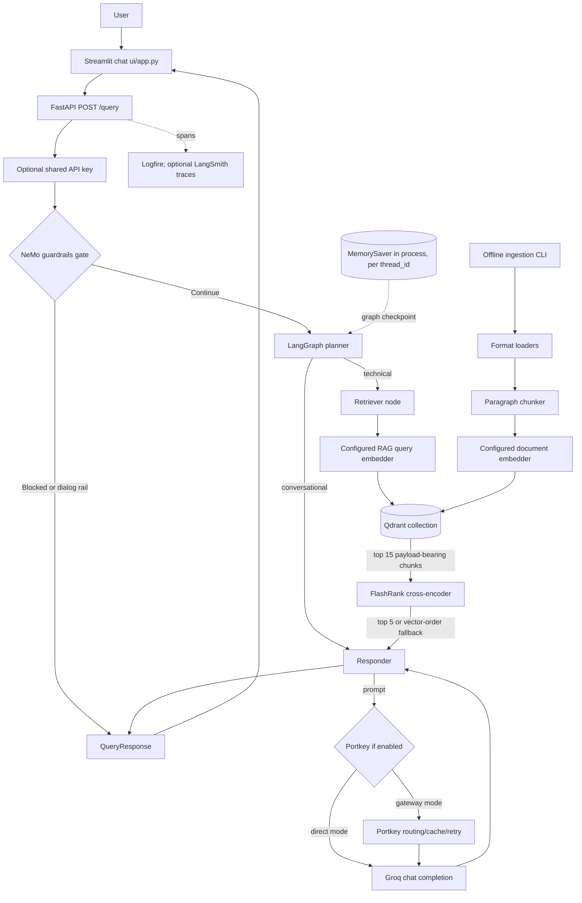
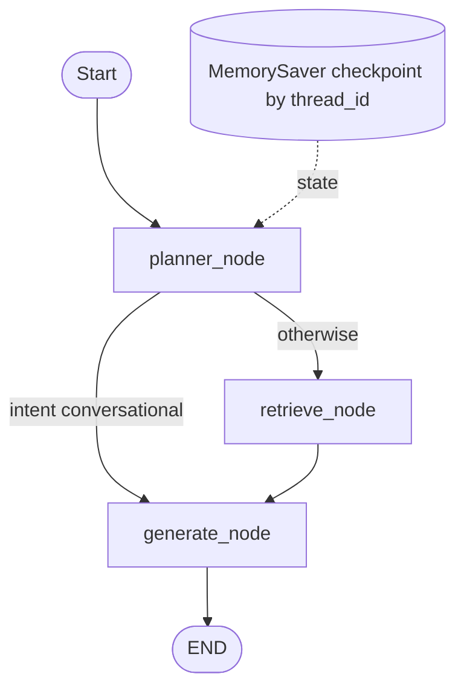

# Enterprise RAG Pipeline: Project and Interview Guide

This guide describes the code in this repository, not an idealized RAG service. It distinguishes verified behavior from likely motivation and recommendations. When documentation conflicts with executable code, the code is treated as authoritative and the mismatch is called out.

## 1. How to Run It

### Prerequisites

- Windows, macOS, or Linux. Local development is Python; there is no Node.js frontend or Node runtime requirement.
- Python 3.12 or 3.13 is the documented local recommendation. `scripts/preflight.py` accepts Python 3.10 through 3.13; the production Dockerfiles use Python 3.11. The development requirements are mostly unpinned, so use the tested Python version rather than assuming every dependency works on a newer interpreter.
- Git and internet access for package/model downloads and the external API calls.
- A Groq API key for NeMo's guardrail LLM and, in local mode, answer generation.
- **A Gemini API key is also required to initialize NeMo Guardrails**, even when `LOCAL_MODE=true` and RAG document embeddings are local. `app/guardrails/rails.py` explicitly raises if `GEMINI_API_KEY` is unset; `app/guardrails/colang_rules.py` configures NeMo's separate flow-embedding provider to Google. This contradicts the current `.env.example`, `README.md`, and `DEMO.md` claim that the local demo needs only Groq. Treat this as a real setup requirement until the implementation changes.
- The provided local route uses embedded Qdrant and needs no separately running database. There is no SQL database, Redis, database migration, Docker Compose file, or initialization service to start.

### Dependency choices

- `requirements-demo.txt` is the smaller UI/demo install. It excludes evaluation-only dependencies and local PDF fallback support. On Windows, install the CPU-only PyTorch wheel first because `sentence-transformers` otherwise may pull a large CUDA build.
- `requirements.txt` is the broader local development install, including test/evaluation and additional document parsing dependencies. It is not locked.
- `requirements-prod.txt` is pinned for the serving container. It omits Streamlit, RAGAS, and `sentence-transformers`; it is not an appropriate local-mode install if you need local RAG embeddings.
- For a normal Windows demo, the documented and least surprising setup is Python 3.12 plus the demo requirements and CPU PyTorch.

### Fresh clone to tested application

```text
Fresh Clone
    |
    v
Install Python 3.12 and create/activate a virtual environment
    |
    v
Install CPU PyTorch, then requirements-demo.txt
    |
    v
Create .env; set GROQ_API_KEY, GEMINI_API_KEY, LOCAL_MODE=true
    |
    v
Run preflight and index DATA/true_data
    |
    v
Start API and Streamlit UI
    |
    v
Check /health, query, and /docs
```

### Copy-paste setup: Windows PowerShell

Run these from the repository root. After copying `.env.example`, edit `.env` and enter actual credentials locally; do not paste keys into source files or this guide.

```powershell
py -3.12 -m venv .venv
.\.venv\Scripts\Activate.ps1
python -m pip install --upgrade pip
python -m pip install torch --index-url https://download.pytorch.org/whl/cpu
python -m pip install -r requirements-demo.txt
Copy-Item .env.example .env
```

Set at least these `.env` values:

```dotenv
GROQ_API_KEY=<your Groq API key>
GEMINI_API_KEY=<your Google AI Studio API key>
LOCAL_MODE=true
```

Then run the following in the activated environment:

```powershell
python scripts/preflight.py
python -m app.ingestion.processor DATA/true_data true --wipe
python scripts/demo.py
```

The launcher starts the API on `http://127.0.0.1:8000` and Streamlit on `http://localhost:8501`, waits for health, then opens a browser. Useful alternatives are `python scripts/demo.py --api-only`, `--skip-preflight`, `--port 9000`, and `--no-browser`. The standalone API docs are at `http://127.0.0.1:8000/docs`; health is at `/health`.

**Do not ingest while the local API is holding embedded Qdrant open.** Stop the API first. The embedded Qdrant directory has an exclusive process lock.

### Verify with HTTP

In PowerShell, after the demo is running:

```powershell
Invoke-RestMethod http://localhost:8000/health
Invoke-RestMethod -Method Post http://localhost:8000/query `
  -ContentType 'application/json' `
  -Body '{"q":"How do I autoscale pods in Kubernetes?","thread_id":"smoke-test"}'
```

When `API_KEY` is non-empty, add `-Headers @{ 'X-API-Key' = '<the same local API_KEY>' }` to the POST. An empty key disables query authentication, which is convenient locally but not acceptable for a public deployment.

### Services, Docker, and initialization

| Concern | Actual repository behavior |
|---|---|
| API and UI | FastAPI/Uvicorn and Streamlit are separate processes; `scripts/demo.py` launches both. |
| Vector store, local | Qdrant embedded in the process, persisted under `.qdrant_local` by default. Index it once with the ingestion CLI. |
| Vector store, cloud | Qdrant Cloud is supported when `USE_LOCAL_QDRANT=false`; configure `QDRANT_CLUSTER_ENDPOINT` and optionally `QDRANT_API_KEY`. |
| RAG embeddings | Local `all-mpnet-base-v2` (768 dimensions) in normal local mode; Gemini (configured model, expected 3072 dimensions) in cloud mode; optional FastEmbed (384 dimensions) when installed and enabled. |
| NeMo flow embeddings | Separately configured to Google `gemini-embedding-001`; this is why NeMo startup requires a Gemini credential even when RAG's local embedder is selected. |
| LLM | Groq is used directly in local mode. Cloud mode normally routes generation/planner calls through Portkey, while guardrail classification still uses Groq directly. |
| Docker | Root `Dockerfile` is a Python 3.11 serving image. `deploy/render/Dockerfile` bakes in embedded Qdrant data and uses Gemini embeddings. `deploy/gcp/Dockerfile` is an alternate embedded-Qdrant/local-embedding image. |
| Compose/migrations | No Docker Compose, SQL schema migrations, or database migration tool is present. Collection creation/rebuild is handled by the ingestion CLI. |
| External services | Groq is required for model calls; Gemini is required for NeMo initialization and for cloud RAG embeddings; Qdrant Cloud and Portkey are optional in local mode. Logfire and LangSmith are optional. |

The deploy files are not interchangeable. The root Dockerfile's defaults are cloud-oriented and require configuration/secrets; `deploy/render/Dockerfile` explicitly sets embedded Qdrant, Gemini embeddings, and direct Groq. The GCP image uses local sentence-transformers embeddings. A local Docker launch is not the same configuration as `scripts/demo.py`.

### Common setup failures

| Symptom | Likely cause and response |
|---|---|
| Startup fails with a missing `GEMINI_API_KEY` | NeMo guardrail-flow embeddings require it in every mode. Add a valid key, even if RAG embeddings are local. |
| `GROQ_API_KEY` rejected or model unavailable | Check the key and account model access. `scripts/preflight.py` checks the configured generation and guardrail model names with Groq. |
| All answers report that documentation has no answer | Check `/health` for an existing, non-empty index; run ingestion. A failed Qdrant query is also converted to empty results, so inspect logs before concluding the corpus lacks the answer. |
| Qdrant vector dimension mismatch | The collection was indexed with a different embedder. Re-run ingestion with `--wipe` after changing model/backend; dimensions are 768, 384, or 3072 depending on configuration. |
| Local Qdrant says it is already accessed | Stop the API/demo process, then run ingestion. Only one process may hold the embedded store directory. |
| First run is slow | Embedding/reranking model files may need downloads; NeMo initializes rails during API startup. |
| Gemini ingestion hits quota | Ingestion batches texts and retries recognized rate-limit errors, but this is not unlimited retry or a guarantee against exhausted quota. Reduce corpus/batch pressure or use local embeddings. |
| A hosted query returns 401 | The `X-API-Key` does not match the backend's `API_KEY`, or the client omitted it. |
| Guardrails unavailable | `/query` fails closed with 503 when guardrail execution errors; inspect startup/runtime logs and ensure both keys are present. |

The preflight script does not check `GEMINI_API_KEY` when local RAG embeddings are enabled, despite NeMo needing it at app startup. Do not treat a green local-mode preflight as proof that guardrail startup will succeed.

## 2. Project Overview

### In plain terms

This is a question-answering assistant over a small corpus of technical documentation. A user asks through a Streamlit chat UI or the FastAPI endpoint. NeMo Guardrails screens the message; a LangGraph workflow then decides whether it needs document retrieval or can be answered from conversation history. Technical questions are embedded, searched in Qdrant, reranked locally with FlashRank, and answered by a Groq-served model using retrieved excerpts. The answer prompt asks for inline block citations and the API also returns source-bearing chunks. The system has an offline ingestion command, a live-query evaluation dashboard, optional tracing, and configurable local/cloud backends. It is more than a basic single-call RAG demo because it has routing, conversation checkpoints, two-stage retrieval, input guardrails, source metadata, gateway configuration, and evaluation tooling. It is still a portfolio-scale system with explicit reliability, security, evaluation, and deployment limitations.

### Tell me about your project (short version)

I built a documentation assistant that answers technical questions from a curated corpus rather than relying only on an LLM's general knowledge. Documents are parsed and split into paragraph-grouped chunks, embedded, and stored in Qdrant. On each request a guardrail gate runs first, then a LangGraph planner either handles a conversational follow-up or rewrites a technical question for search. The retriever gets 15 vector candidates and FlashRank reranks them to five before the responder builds a context-limited prompt for Groq. The answer is asked to cite numbered source blocks, and the API returns the retrieved chunks and filenames as well. I also added local/cloud configuration, health reporting, tracing hooks, tests, and a RAGAS-based evaluation UI. The main tradeoffs I can explain are the lack of chunk overlap, process-local conversation memory, and the fact that citation/faithfulness instructions are not enforced by a validator.

### Actual functionality versus intended value

**Implemented:** document parsing/indexing; local or cloud Qdrant; three embedding backends in code; guardrail classification and canned refusals; planner classification and query rewriting; retrieval and reranking; context assembly and answer generation; thread-keyed in-memory conversation state; FastAPI API; Streamlit chat; health/graph endpoints; tracing integrations; evaluation UI and tests.

**Not implemented in this repository:** user accounts/roles; document upload API; automatic/scheduled ingestion; SQL application database; persistent/shared conversation store; BM25 or hybrid retrieval; a citation validator; output factuality checker; response streaming; distributed task queue; production rate limiting; CI quality gate based on evaluation scores.

## 3. Technology Stack

| Technology | Where used | Why it is used here | Alternative (not a repository decision) |
|---|---|---|---|
| Python 3.11-3.13 | `app/`, scripts, tests; Docker uses 3.11 | Application, ingestion, evaluation, and service code | Other supported server languages/frameworks |
| FastAPI + Pydantic | `app/main.py` | HTTP API, request validation, typed response schema, OpenAPI docs | Flask, Django REST Framework |
| Uvicorn | scripts and Docker commands | ASGI server for FastAPI | Hypercorn, Gunicorn with Uvicorn workers |
| Streamlit | `ui/app.py`, `evals/app.py` | Chat UI and interactive evaluation dashboard | React/Next.js, Gradio |
| LangGraph | `app/agents/graph.py`, `state.py`, nodes | Explicit state transitions, conditional routing, checkpointer integration | Plain Python orchestration or LangChain Runnable chain |
| LangChain | planner LLM adapters and model integrations | Common invocation interface and provider adapters | Direct provider SDKs |
| NeMo Guardrails + Colang | `app/guardrails/` | Input topic/jailbreak/dialog flow gate | Custom policy layer, another guardrail product |
| Groq API | gateway client and NeMo `ChatGroq` | Hosted chat completion models for guard and generation | Other hosted inference providers |
| Portkey | `app/gateway/client.py` | Optional gateway routing, primary/fallback targets, simple cache, retry policy | Direct provider calls, another LLM gateway |
| Qdrant | `app/services/retrieval/qdrant_service.py` | Vector collection plus text/source payload; embedded or cloud backend | FAISS, Chroma, pgvector, another vector service |
| Gemini embeddings | `app/services/retrieval/embedding.py`; also NeMo's distinct provider config | Cloud-mode RAG vectors; NeMo uses Google embeddings for flow/canonical-form search | Local sentence-transformers, FastEmbed, another embedding API |
| sentence-transformers | optional local RAG embedder; RAGAS judge embeddings | Local `all-mpnet-base-v2` RAG vectors; evaluation uses `all-MiniLM-L6-v2` | FastEmbed, hosted embeddings |
| FastEmbed | optional code path in `embedding.py`; package absent from listed requirements | Memory-conscious 384-dimensional embedding mode if separately installed | sentence-transformers, hosted embeddings |
| FlashRank / ONNX | `app/services/retrieval/ranking_service.py` | Local CPU cross-encoder rerank of vector candidates | Cohere Rerank or another cross-encoder service |
| pypdf, pdfplumber | PDF loader | Text extraction with per-blank-page fallback | PyMuPDF, OCR tooling for scanned PDFs |
| BeautifulSoup | HTML loader | Strip non-content elements and extract text | lxml, trafilatura |
| python-docx, python-pptx | office loader | Text extraction from DOCX and PPTX | `unstructured` or Apache Tika |
| `unstructured` | optional office formats in loader | Fallback for other formats, not used for DOCX/PPTX's main path | Tika, format-specific parsers |
| Logfire | `app/observability.py` and manual spans | Optional spans/log events; local-only mode without token | OpenTelemetry SDK, another tracing backend |
| LangSmith | settings/config environment wiring | Optional LangChain/LangGraph trace export when configured | Langfuse, OpenTelemetry collector |
| RAGAS | `evals/metrics.py` | Faithfulness, answer relevancy, context precision/recall, answer correctness | Human review, DeepEval, custom metric suite |
| GitHub Actions | `.github/workflows/ci.yml` | Unit tests, byte compilation, production image build/start smoke check on `main` | Other CI platforms |
| Docker | root and `deploy/` Dockerfiles | Container packaging for serving deployments | VM/process deployment |

No Node.js, PostgreSQL, Redis, FAISS, Chroma, BM25 engine, or SQL ORM is used by the actual serving pipeline. `MemorySaver` is an in-process LangGraph component, not a database.

## 4. Complete Architecture



### Component details

| Component | What and why | Implementation, input, output | Important details and possible failure |
|---|---|---|---|
| Ingestion CLI | Converts a local directory into an index; kept separate from query serving | `app/ingestion/processor.py`; files -> extracted text -> chunks -> JSON and Qdrant points | Bad/unsupported files can be skipped or logged; processing errors are caught per file, so a run may finish with missing documents. |
| Loaders and chunker | Normalize supported document text and form embedding units | `app/ingestion/loaders/`; `app/ingestion/chunking/splitter.py`; file -> text -> list of strings | No OCR, no rich structural metadata, and a single long paragraph may exceed the nominal size. |
| Embedder | Maps text and queries into vectors | `app/services/retrieval/embedding.py`; text -> float list(s) | Model/key mismatch, API quota, vector width mismatch, or embedding drift. |
| Qdrant service | Stores/query vectors and payloads | `app/services/retrieval/qdrant_service.py`; vector query -> scored point payloads | Embedded disk or remote cloud; client is lazy singleton. No project-defined payload indexes or explicit HNSW tuning. |
| Guardrails gate | Rejects off-topic/adversarial inputs before graph work | `app/guardrails/rails.py`; one user message -> `(blocked, response)` | Fail closed on exception. Rails are initialized at FastAPI lifespan startup; detection relies partly on response text matching. |
| LangGraph planner | Determines if search is needed; rewrites technical query | `app/agents/nodes/planner.py`; state/history -> typed `intent`, `current_query` | A model output format drives intent classification; any non-sentinel output is treated as a search query. |
| Retriever/reranker | Gets broad candidate set and narrows it | `app/agents/nodes/retriever.py`, `qdrant_service.py`, `ranking_service.py`; query -> up to 15 -> up to 5 | Reranker failure falls back to vector order. Query/vector store failure can look like no supporting docs. |
| Responder | Builds a history/context prompt and generates answer | `app/agents/nodes/responder.py`; state/chunks -> answer and updated messages | 25,000-character context cap; no explicit output schema or max-token setting; no citation verification. |
| API/UI | Exposes and presents the service | `app/main.py`, `ui/app.py`; JSON request -> JSON response -> UI rendering | API query endpoint is sync; UI's word reveal is after the entire answer returns, not token streaming. |
| Conversation state | Carries prior turns by thread | `MemorySaver` in `app/agents/graph.py` | RAM only, per process; restart loses state, concurrent instances do not share it. |
| Evaluation | Exercises a golden set and judge metrics | `evals/` | Runs against a live API and external judge; no committed automated score gate. |

## 5. Complete RAG Pipeline

| Stage | Implemented behavior, code, and data flow | Main risk |
|---|---|---|
| Document selection | Local directory supplied to the ingestion CLI; supported extension selected in `processor.py` | No upload endpoint, automated crawl, or scheduled ingestion. |
| Parsing | PDF, HTML, TXT/MD, DOCX/PPTX, plus optional generic office fallback | Scanned PDF OCR is not implemented. Some layout/table structure is flattened or omitted. |
| Preprocessing | HTML tags `script`, `style`, `meta`, `noscript` are removed; whitespace is trimmed/collapsed. Text loaders decode with replacement/ignore behavior. | No broad normalization, language detection, PII removal, or malicious-content screening. |
| Chunking | Paragraphs split on exactly `\n\n` and grouped under a default 1500-character target | No token-aware splitter, true semantic segmentation, forced splitting of long paragraphs, or overlap. |
| Metadata | Each point carries `text`, `source` filename, and `source_type`; processed JSON stores filename/type/chunks | No page number, slide number, section, timestamp, document ID/version, or content hash. |
| Embedding | Batch document embedding (50 text items per batch); query embedded on demand | Model/key mismatch, API quota, vector width mismatch, or embedding drift. |
| Vector storage | Qdrant collection created with active width and cosine distance; points use random UUIDs | Re-ingesting without wipe creates additional duplicate logical content; no deterministic update/delete-by-source behavior. |
| Query intake | API validates non-empty question <= 2000 chars and thread ID <= 128 chars | No per-user identity, rate limiting, or request quota. |
| Guarding/planning | NeMo checks each message; LangGraph planner routes conversational versus technical and rewrites technical queries | Guardrail has no multi-turn conversation context; planner can misclassify/rewrite poorly. |
| Retrieval | Query vector search returns top 15 (configurable), payload included | No hybrid BM25, metadata filter, minimum similarity score, or explicit no-answer score threshold. |
| Reranking | FlashRank cross-encoder reorders candidates; returns top 5 (configurable) | CPU/memory/latency; fallback silently sacrifices reranking quality but preserves availability. |
| Context construction | Numbered blocks include source filename; maximum context 25,000 characters | A long block that alone exceeds limit can stop later smaller blocks from being included. |
| Prompt and generation | Prompts live in planner/responder Python strings; model call temperature is 0.1 for generation | No system-role separation, constrained JSON output, streaming, or configured max output tokens. |
| Validation/guardrails after answer | None in normal RAG response path | Not implemented in this repository. No output fact-checker or citation validator. |
| Response | JSON includes question, answer, thought-process steps, status, sources, blocked, latency, request ID | Citation text is model generated. A response can cite a nonexistent block and nothing checks it. |

## 6. Document Ingestion

**Entry point:** `python -m app.ingestion.processor <directory> [source_type] [--wipe]` calls `run_universal_ingestion()`, which prepares the collection, maps immediate subdirectories to source types, then calls `process_directory()` and `process_file()`.

**Supported formats in `process_file()`:** `.pdf`, `.html`/`.htm`, `.txt`/`.md`, `.docx`, `.pptx`. `parse_office()` can route other office extensions to `unstructured`, but `process_file()` only selects it for DOCX/PPTX, so those other formats do not currently reach that fallback through the normal CLI. Unsupported extensions are logged and skipped.

**Parsers:**

- PDF: `pypdf` extracts page text. Blank pages are retried with `pdfplumber` if installed. There is no OCR path for image-only scans. The fallback text is appended after the regular pages, so original page ordering can be lost for blank pages that become readable in the fallback.
- HTML: BeautifulSoup removes script/style/meta/noscript and emits cleaned text. It is not a domain-specific boilerplate remover.
- TXT/MD: UTF-8 read with `errors="ignore"`.
- DOCX: `python-docx` collects non-empty paragraphs; tables are not explicitly traversed.
- PPTX: `python-pptx` collects text-bearing shapes from slides, joined into plain text; slide metadata is not retained.

After chunking, `processed_data/<source_type>/<filename>.json` stores the filename, source type, and chunks. A Qdrant point is created per chunk with a random UUID and payload `{text, source, source_type}`. This JSON is a local processed artifact, not the serving database. Errors are logged and caught per file, so an ingestion command can have partial success. Empty extraction is skipped. There is no robust duplicate detection: UUIDs mean repeat ingestion can insert repeated content. `--wipe` deletes and recreates the entire configured collection, not just one source. Treat `--wipe` carefully if a shared/cloud collection contains other indexed content.

The checked-in `DATA/true_data` has six sample files (HTML, TXT, DOCX, PPTX) described in `DATA/true_data/README.md`. `DATA/noisy_data` is a much larger distractor corpus and includes formats beyond the sample corpus; not every file type is guaranteed supported. The deployment report describes a live corpus of 43 vectors, but that is a deployment snapshot rather than a code invariant.

## 7. Chunking

`app/ingestion/chunking/splitter.py:chunk_text(text, chunk_size=1500)` splits only on double-newline paragraph boundaries and concatenates consecutive paragraphs until the threshold would be exceeded. It has no overlap and carries no metadata itself. It aims to avoid cutting ordinary paragraphs in half, but the docstring's “semantic-ish” wording should not be mistaken for an embedding-based semantic chunker.

The algorithm also does not actually guarantee that chunks stay under 1500 characters: if one paragraph is larger than that threshold, it is emitted whole. That behavior is explicitly tested in `tests/test_chunking.py`.

- **Too-small chunks:** definitions and their qualifications can be separated; retrieval may find a fragment without enough context, and more chunks consume vector/index space.
- **Too-large chunks:** vectors represent mixed topics, relevance gets blurrier, prompts grow, and unrelated statements can be presented to the LLM together.
- **Overlap:** preserves a small amount of boundary context when splitting; this implementation has none, and splitting only between paragraphs avoids some but not all boundary loss.
- **Reason for current strategy:** likely chosen for simplicity and to preserve paragraphs, but the repository does not establish the original decision beyond code comments.
- **Reasonable V2:** use a token-aware recursive splitter with configurable overlap, preserve source/page/slide/heading metadata, split pathological single paragraphs, and evaluate retrieval on the golden set plus boundary cases. Do not claim that such a splitter is already present.

## 8. Embeddings

**Simple analogy:** an embedding is like placing a sentence at a location on a map where sentences with similar meaning tend to be close. A search question can then find nearby document passages even when the wording differs.

**Technically:** the embedding model maps text to a fixed-length numeric vector. Qdrant compares query and document vectors using cosine distance. Each document chunk is embedded once at ingestion; each technical query is embedded during retrieval. The document and query vectors must come from compatible model/configuration and have the same width.

| Mode | RAG embedding model | Dimension | Code/config |
|---|---|---:|---|
| Default local mode | Sentence Transformers `all-mpnet-base-v2` | 768 | `LOCAL_EMBED_MODEL`, `USE_LOCAL_EMBEDDINGS` |
| Cloud RAG mode | `models/gemini-embedding-2-preview` by default | 3072 expected by code | `GEMINI_EMBED_MODEL`, `GEMINI_API_KEY` |
| Optional memory mode | FastEmbed `BAAI/bge-small-en-v1.5` by default | 384 | `USE_FASTEMBED`, `FASTEMBED_MODEL`; package is not listed in the provided requirements files |

`embedding.py` lazily selects and initializes the model and probes Gemini with a real call. Text embedding uses batches of 50. Gemini ingestion retries recognized rate-limit/quota failures with increasing waits, but there is no equivalent retry around every query path. Qdrant stores vectors alongside source/text payload. NeMo separately uses Google `gemini-embedding-001` for its guardrail flow search; that is not the same model/configuration as the app's RAG embeddings.

**Limitations:** semantic similarity is not exact keyword matching; close vectors can still be irrelevant; embeddings may miss rare identifiers or exact syntax; model changes require reindexing; vectors alone do not establish factual correctness. There is no embedding-version field in each point or automatic migration strategy.

## 9. Vector Database

The actual vector store is **Qdrant**. `qdrant_service.get_client()` lazily creates one client: `QdrantClient(path=...)` for embedded local disk, or a URL/API-key client for Qdrant Cloud. The collection defaults to `enterprise_rag`. Ingestion creates a single unnamed vector config with active dimension and `Distance.COSINE`. Payload fields are `text`, `source`, and `source_type`.

Retrieval calls `query_points(collection_name=..., query=query_vector, limit=..., with_payload=True)`. No metadata filter is supplied. The client/library owns index implementation defaults; the repository does not configure payload indexes, HNSW tuning, sharding, replication, or collection aliases. Embedded mode is single-process due to a file lock; it is useful for demos but not a multi-instance shared store. Cloud storage is supported but its operational configuration is external.

**Why Qdrant versus FAISS?** The repository does not establish the original reason. A technically reasonable explanation is that Qdrant offers the same client/API for a local embedded store and managed cloud backend, with payload-bearing points and server-side filtering available later. FAISS is an excellent in-process similarity-search library, but by itself it does not provide the same managed-service API/operations. Do not claim a benchmark-based choice.

**Why not Chroma?** The repository does not establish the original reason. A reasonable defense is that Qdrant was selected and the code is built around its client; Chroma could also support a small prototype, and an interview answer should acknowledge that the repo contains no comparative benchmark.

**Millions of vectors?** This repository has no load test or scaling evidence. A managed Qdrant cluster can be configured for larger workloads, but the code does not tune indexes, shard/replica strategy, payload indexes, or ingestion concurrency. At that scale measure recall/latency and memory, tune HNSW and filters, provision appropriately, and reconsider chunk duplication and dimensions. The single-instance application/checkpointer and lack of load tests are separate constraints.

## 10. Retrieval

For a technical turn, the planner's rewritten query is passed to `retrieve_node()`. `search_enterprise_knowledge()` embeds it, calls Qdrant cosine search for `RETRIEVAL_SEARCH_LIMIT` (default 15), and returns each matching chunk with source, source type, and rounded similarity score. There is no minimum score threshold; top-k points are returned if present, even if all are poor matches. There is no metadata filtering, BM25, hybrid search, query expansion, or query rewriting beyond the planner's LLM-based standalone-query rewrite.

**Cosine similarity, simply:** compare the angle between two vectors. If vector directions are similar, their cosine similarity is high; vector magnitudes matter less. Qdrant is configured with cosine distance, which it uses to order nearest points.

**Mathematically:** for nonzero vectors `a` and `b`, cosine similarity is

$$
\operatorname{cos}(a,b)=\frac{a\cdot b}{\|a\|\,\|b\|}.
$$

The API's `score` is the Qdrant returned similarity value rounded to four decimals. It is informational; no threshold gates use it. `source_type` is retained but not used as a filter. Search catches all exceptions, logs them, and returns `[]`; this preserves service flow but can turn a database outage or dimension mismatch into an apparently empty corpus answer.

## 11. Reranking

Initial vector search is fast and indexable because document vectors are precomputed, but the query and passage are represented independently. A reranker evaluates each query/passage pair together, which can improve ordering among a small candidate set but costs more compute per candidate.

```text
Query -> Qdrant top 15 -> FlashRank cross-encoder -> top 5 -> answer context
```

`app/services/retrieval/ranking_service.py` lazily initializes FlashRank's ONNX CPU ranker; default model is the library's default (the code comments and deployment use `ms-marco-MiniLM-L-12-v2`; `FLASHRANK_MODEL` can override it). It sends `{id, text}` passages and maps ranked IDs back to original dicts, preserving filename and vector score while adding `rerank_score`. The retriever defaults are 15 input candidates and 5 retained chunks.

If model loading or ranking fails, it logs the error and returns the first `top_n` vector results. This is graceful degradation, not zero downtime at the entire service level. A local ONNX model avoids a ranking API and per-query ranking charge, but consumes memory/CPU and may add first-use model download/startup behavior. No repository benchmark proves a fixed latency or accuracy gain. “Cohere is more accurate” or “reranking takes X milliseconds” is not established by this repo.

## 12. Prompts and Prompt Engineering

Prompts are Python f-strings, not separate prompt files. Calls pass a single `role: user` message containing the prompt text; the repository does not send these as a structured system message.

| Prompt | Purpose and content |
|---|---|
| Planner in `app/agents/nodes/planner.py` | Receives transcript history and latest message. Must output the exact `CONVERSATIONAL` sentinel for greetings/acknowledgements/history-only questions; otherwise output only a standalone technical search query, resolving pronouns/references. The function normalizes punctuation/case around the sentinel. Any other output is treated as technical query text. |
| Conversational responder | Instructs the model to answer briefly from conversation history. No retrieved documents or source citations are included. |
| Empty-context responder | Says search returned no material, asks for rephrasing, and explicitly says not to use general knowledge or speculate. |
| Grounded technical responder | Provides numbered context blocks with source filenames, conversation history, and latest question. Rules say to use only context, cite every factual claim with a block number, and explicitly identify missing coverage. |
| Guardrail YAML/Colang | Limits assistant scope to Kubernetes, Intel hardware, and enterprise networking; includes examples/flows for off-topic requests, jailbreaks, greetings, capabilities, and farewells. |

The structure aims to make routing explicit, ground technical answers in retrieved text, support citations, and admit missing context. But these are instructions, not enforcement: citations are not parsed, block IDs are not validated, and the model can still add unsupported claims. The history and question are interpolated directly into prompt text; there is no escaping scheme or prompt-injection isolation beyond the gate and instructions.

## 13. LLM and Gateway

| Call | Provider/model | Configuration |
|---|---|---|
| Guardrail classification | Groq through LangChain `ChatGroq`; default `llama-3.1-8b-instant` | Temperature 0; `reasoning_format="hidden"` is set for the configured reasoning-model behavior. Always direct Groq, not Portkey. |
| Planner | Groq model via `ChatOpenAI` adapter pointed at Portkey or Groq OpenAI-compatible endpoint | Temperature 0; model defaults to `llama-3.3-70b-versatile`; constructed lazily. |
| Answer generation | Groq through Portkey native client if gateway mode, or a wrapped OpenAI client pointed at Groq in direct mode | Temperature 0.1. Model default is `llama-3.3-70b-versatile`. No `max_tokens` or structured output is set. |
| RAGAS judge | Groq `llama-3.1-8b-instant` through OpenAI-compatible endpoint | Uses `JUDGE_GROQ`, falling back to `GROQ_API_KEY`; separate from serving control is recommended but not enforced. |

Cloud gateway configuration (`GATEWAY_CONFIG`) sets fallback strategy with two model targets, simple cache, and two retry attempts on HTTP 429/503. Direct mode disables those Portkey features. The fallback's actual model/key/availability depends on the configured virtual keys and provider account. The responder checks the Portkey cache response header and reports a hit in its thought process; direct mode will not have a Portkey cache.

The repository does not establish the original model selection rationale. A plausible explanation is using a larger hosted model for planning/answer synthesis and a smaller, low-temperature model for guard classification. Do not claim evidence of a model benchmark, latency comparison, or proven cost optimum. There is no token usage accounting in the response schema, no output streaming from the API, no explicit fallback model outside gateway mode, and no project-configured provider-call timeout/retry around direct Groq calls.

## 14. Hallucination Reduction

Implemented mitigations: retrieval supplies corpus context; the grounded prompt says not to use outside knowledge and asks for inline citations; the empty-context branch explicitly refuses to speculate; source filenames travel through Qdrant and the reranker; NeMo screens the input before the graph.

These reduce risk; they do not eliminate hallucinations. The search has no relevance threshold, retrieved passages may be wrong, the model may ignore instructions, a citation may be fabricated or point to a block that does not support the claim, and no output fact-checker/citation verifier runs. The no-context message can also be triggered by retrieval infrastructure failure because search exceptions are converted to an empty list.

## 15. NeMo Guardrails

NeMo is meaningfully used. `app/main.py` initializes rails once in FastAPI lifespan and calls `guard(request.q)` before invoking LangGraph. A blocked result returns immediately with `blocked=true`, no documents, and “Retrieval: Skipped.” A guardrail runtime exception yields HTTP 503, so the API fails closed rather than continuing unguarded.

`app/guardrails/colang_rules.py` has user intents/flows for off-topic requests and jailbreak attempts, plus greetings, capability questions, and farewells. YAML gives topic instructions for Kubernetes, Intel, and networking and configures NeMo flow/canonical-form embedding search to Google's provider (`gemini-embedding-001`). It does not configure a separate output fact-check rail, PII rail, or data-leak rail. The gate sees only the current message, not the LangGraph conversation state.

The guard model is Groq `GROQ_GUARD_MODEL`, with temperature zero. `GEMINI_API_KEY` is bridged into `GOOGLE_API_KEY` for NeMo's provider. NeMo's result has no structured “flow fired” flag used here; `guard()` checks whether response text contains `RAIL_INDICATORS`, then checks leading refusal phrases for the configured reasoning model. That text-coupling is fragile. `tests/test_guardrails_config.py` protects the Colang-indicator synchronization, but this mechanism is not a formal safety proof. A false negative can pass a malicious message; a false positive can block legitimate work. No system can guarantee prompt-injection prevention just from these rails.

## 16. Agents and LangGraph



`AgentState` in `app/agents/state.py` stores `messages`, typed `intent`, `current_query`, `documents`, `plan`, `status`, and `final_answer`. `messages` uses `Annotated[..., operator.add]`, so a node returning a new message appends it; ordinary returned state keys replace existing values. `route_planner()` checks only `intent`; unknown/missing intent routes to retrieval. There are three nodes: planner, retriever, responder. There are no registered external tools, loops, conditional retry edges, or graph-level error recovery beyond node behavior and the API exception handler.

`MemorySaver` stores checkpoints in process memory keyed by `thread_id`. It is not durable, shared, or an external database. Deployment documentation deliberately limits service instances/workers because of this. LangGraph makes the state and conditional control flow visible and supports checkpoints; a simple function chain could implement the current DAG, but would need custom state/history persistence and routing code. The repository does not establish that LangGraph was chosen after a measured comparison.

## 17. Backend

FastAPI is defined in `app/main.py`:

| Endpoint | Behavior | Access |
|---|---|---|
| `GET /` | Service name/version/docs path | Public |
| `GET /health` | Guardrail readiness, Qdrant collection stats, selected modes, auth/CORS status | Public |
| `GET /graph` | Requests a PNG rendering of the compiled LangGraph | Public; can return 503 if Mermaid rendering cannot reach its renderer |
| `POST /query` | Validates request, checks optional API key, runs guardrail, invokes graph, returns typed result | Shared API key if `API_KEY` is configured |

`QueryRequest.q` has length 1-2000; `thread_id` defaults to `default_user` and has max length 128. `QueryResponse` carries question, answer, thought process, status, sources, blocked, latency milliseconds, and request ID. Graph and services are imported into the module, while NeMo initialization is deferred to lifespan. CORS is installed only when comma-separated `ALLOWED_ORIGINS` is non-empty. No custom middleware, user/session authentication, authorization roles, rate limiter, or background task queue is implemented.

Request flow: HTTP -> Pydantic validation -> `require_api_key` -> `guard()` -> early refusal or `rag_agent.invoke(..., thread_id)` -> graph nodes/services -> `QueryResponse`. Guardrail errors become 503; graph/model errors become 500 with the request ID in detail. The handler is synchronous (`def query`), and graph invocation is synchronous. No API token streaming is implemented. The UI's word-by-word rendering is only a visual reveal after the full answer arrived.

## 18. Database and Persistent Storage

| Store | Data and lifecycle | Read/write path |
|---|---|---|
| Qdrant | Vector collection plus chunk text/source/source_type payload. Local embedded path is `.qdrant_local`; cloud collection is configured externally. Collection dimension and cosine metric are chosen at ingestion. | Ingestion creates/upserts; query service searches; `--wipe` deletes and recreates the whole collection. No migration system or deterministic duplicate cleanup. |
| `processed_data/` JSON | Local extracted chunk lists plus filename and source type; can help inspect ingestion output. | `process_file()` writes JSON. Serving queries read Qdrant, not these JSON artifacts. |
| LangGraph `MemorySaver` | Conversation checkpoints, in process RAM, keyed by thread ID. | Graph invocation/checkpointer; destroyed on process restart. No external persistence. |
| Streamlit session state | Visible UI messages, session/thread ID, queued prompt, evaluation results. | `ui/app.py`/`evals/app.py`; tied to the Streamlit session/process, not an account database. |

Not implemented: PostgreSQL, Redis, relational schema, ORM, database migrations, durable conversation history, or a persistent evaluation result store by default. The repository contains no database relationships or application-level SQL indexes.

## 19. Observability

`app/observability.py` centralizes Logfire configuration. With a token it exports; without one it configures local-only mode and does not intentionally fail the app. Source code adds manual spans/logs around API turns, guardrails, planning, retrieval, reranking, generation, and ingestion. `ui/app.py` also instruments `requests` to propagate trace context when available. `app/config.py` wires LangSmith environment variables when a key is set.

There is useful tracing and structured event context, including request ID, thread ID, query preview, reranking duration, and candidate counts. The API health payload provides readiness/index/backend configuration. But there is no Prometheus metrics endpoint, SLO dashboard, alerting configuration, systematic token/cost accounting, or persisted latency histogram. Do not say “every response is traced” unless Logfire/LangSmith is configured and available. The code logs user query fragments and prompt-related data, which has privacy implications.

## 20. Evaluation

### Implemented

- `evals/golden_dataset.json` contains 15 RAG question/reference samples and six guardrail cases. The corpus README calls out six tracked `true_data` files; the set is small and corpus-specific.
- `evals/pipeline.py` POSTs golden questions to a running API, captures the answer (truncated to 300 characters), actual retrieved chunk text/sources, and infers the selected route from `thought_process`.
- `evals/guardrails_eval.py` labels outcomes TP/TN/FP/FN and calculates precision, recall, and accuracy.
- `evals/metrics.py` evaluates Faithfulness, Answer Relevancy, Context Precision, Context Recall, Answer Correctness, and Tool Correctness. The first five are RAGAS judge metrics; tool correctness is a Jaccard-set score from detected and expected route labels. It uses Groq as judge and local HuggingFace embeddings for embedding-based RAGAS metrics, truncates contexts, and inserts cooldowns for rate limits.
- `evals/app.py` gives a Streamlit workflow for ground truth, live pipeline capture, guardrail evaluation, and metric scoring.
- Unit tests cover pure eval helpers and guardrail confusion-matrix arithmetic.

### Not implemented / limitations

There is no committed evaluation report, no CI threshold/gate on quality scores, no broad independent test corpus, no production-user feedback loop, and no measured retrieval recall benchmark at larger scale. `actual_tools_called` is inferred from text labels, not true low-level tool instrumentation. `run_pipeline()` truncates actual answers and contexts for scoring, which is an evaluation compromise. LLM-as-judge scores are not ground truth and can be noisy. Historical claims in docs about exact scores should not be repeated without a saved run artifact and its configuration.

### Recommended answer if asked how to evaluate it

I would separately measure retrieval and generation. For retrieval, compute Recall@k/MRR or nDCG against manually labeled relevant chunks and include hard negatives. For generation, keep Faithfulness, Answer Relevancy, and Answer Correctness, but review a stratified human sample and validate citation IDs and source support mechanically. Add refusal/guardrail precision and recall over a larger, adversarially varied set. Fix model, corpus, prompts, and dependency versions per run; store results; establish regression thresholds; and test failures, empty retrieval, mode changes, and latency/cost across realistic traffic. These are recommendations, not current capabilities.

## 21. Security

| Area | Verified state |
|---|---|
| Secrets | `.env` is ignored and `.env.example` is the template; deploy docs recommend secret stores. Runtime credentials are environment variables/Streamlit secrets. Never commit real keys. |
| Authentication | Optional shared `API_KEY` on only `POST /query`; blank means unauthenticated. Health/root/graph are public. Shared key has no user identity, scopes, rotation lifecycle, or per-user revocation. |
| Authorization | Not implemented in this repository. Any caller with the shared key can choose/reuse any `thread_id`; no ownership check. |
| Rate limiting/abuse controls | Not implemented in this repository. A key holder can consume upstream quotas. |
| Prompt injection | Guardrails screen current user input, and answer prompt says use retrieved context only. This is mitigation, not robust isolation. Retrieved documents are not screened for embedded instructions, and no output validation exists. |
| Upload validation | No HTTP document upload endpoint exists. Ingestion reads local filesystem paths supplied to a CLI. This limits remote upload attack surface but does not make untrusted local files safe. |
| SSRF | No user-supplied URL fetching path in the serving API was found. The ingestion code parses local files; the repository does not establish a general SSRF defense. |
| PII/data leakage | No PII detection/redaction. Query previews, thread IDs, and operational context may be logged; prompts and documents are sent to external Groq/Gemini/Portkey services according to mode. Data-retention/provider controls are external and could not be verified from the repository. |
| CORS | Opt-in allowlist; no wildcard default. CORS is not authentication. |
| Container | Dockerfiles use an unprivileged `appuser`, slim Python image, and OS package upgrade. This is a useful hardening measure but not a complete container security program. |
| Dependencies | Development dependencies are unpinned; production pins are maintained. No dependency scanning policy is defined by the workflow shown. |

Do not describe the application as secure because it has an API key and guardrails. The key is a shared bearer secret; there is no proper identity, authorization, rate control, or document/output security boundary.

## 22. Performance

The known serial path is guardrail inference -> planner inference -> query embedding -> vector search -> reranking -> answer inference for technical questions. Conversational planner turns skip the retrieval and reranking stages. The reranker is local ONNX on CPU; ingestion batches document embeddings; FlashRank is lazy-loaded; context is limited to 25,000 characters; Portkey simple cache/retries exist only when the gateway is enabled.

The largest likely latency components are external model calls (guardrail, planner, answer, and cloud embedding), network/vector access in cloud mode, NeMo startup, and first-use model downloads. There is no API streaming, explicit concurrent batching of serving requests, query-result cache in app code, or project-level timeout around all upstream calls. The UI's health result is cached for 30 seconds; that is not RAG response caching. No repeatable load/latency benchmark or percentile SLO is included. A deployment report's individual observed query time is not a general performance guarantee.

## 23. Cost

```text
RAG embeddings (Gemini if cloud; local compute if local)
+ NeMo flow embeddings (Google provider at rail initialization)
+ Guardrail and planner/answer LLM tokens (Groq)
+ Qdrant Cloud capacity/network (if cloud)
+ Portkey plan (if gateway mode)
+ Optional Logfire/LangSmith and evaluation judge calls
+ Local CPU/RAM for FlashRank and local embeddings
```

Current cost controls: choose local RAG embeddings/Qdrant/direct Groq in demo mode; use the small guardrail model; retrieve 15 and keep five; batch ingestion embeddings; limit context characters; Portkey simple cache and 429/503 retries when enabled; keep evaluation separate and rate-limited with cooldowns. Reranking itself uses local CPU rather than a per-request ranking API. NeMo's Google embedding provider remains external in either documented local mode.

At higher traffic I would instrument token usage and per-stage cost first, add quotas/rate limiting, cache stable retrieval/answers with tenant-safe keys, batch/queue ingestion, compare embedder sizes/quality, and load-test Qdrant and model concurrency. I would also budget guardrail and planner calls, not just final answer tokens.

## 24. Failure Modes

| Failure | Likely cause | Current handling | Better handling |
|---|---|---|---|
| Bad/unsupported document | Corrupt, scanned, or unsupported file | Unsupported file skipped; per-file exceptions logged; empty parse skipped | Validate formats, quarantine failures, OCR if needed, return ingestion summary and retry/dead-letter queue |
| Empty retrieval | Empty collection or no points | Responder returns an explicit “documentation does not cover it” prompt; `/health` marks empty index degraded | Distinguish empty corpus from query/provider/database failure; return retrieval diagnostics |
| Irrelevant retrieval | Weak embedding match or corpus gap | Always returns top-k; no score threshold; reranker improves order | Relevance calibration, no-answer threshold, hybrid search, evaluation and human review |
| Vector DB failure | Endpoint/auth/network/schema mismatch | Collection stats returns error; query search catches and returns `[]` | Propagate typed 503/504 errors; bounded retries/timeouts, circuit breaker, alerting |
| Embedding API failure | Key, quota, network, wrong model | Gemini initialization raises; ingestion rate-limit retry; query service ultimately returns empty on search exception | Explicit dependency health, bounded retry/backoff at query time, distinguish outage from no result |
| LLM API failure | Provider error, invalid key/model, quota | Generation errors re-raised and API returns 500; Portkey retries 429/503 when enabled | Explicit timeout, provider error mapping, observability/alerts, quota-aware fallback in direct mode |
| LLM timeout/hang | Slow/unresponsive provider | No project-level timeout policy identified; UI requests time out at 120 seconds | Set bounded connect/read/request deadlines and propagate cancellation |
| Malformed output | Model returns unexpected content | Planner treats non-sentinel text as search query; answer accepts message content | Validate structured outputs and use bounded repair/fallback |
| Rate limits | Groq/Gemini free/on-demand limits | Portkey retry only for configured statuses; ingestion Gemini retries; eval cooldowns; direct generation can fail | Central rate limiter, backoff/jitter, request queue, separate quotas/keys |
| Invalid user input | Empty/oversized question, invalid fields | Pydantic returns 422; question max 2000 chars | Add content/encoding policy and abuse limits if service becomes public |
| Hallucinated answer/citation | Missing/wrong context or model ignores prompt | Grounding instructions, source blocks, empty-context refusal | Citation-to-chunk validation, claim support checks, calibrated abstention, human escalation |
| Prompt injection | Malicious user text or document instructions | NeMo input gate plus grounding prompt | Treat all retrieved text as untrusted, isolate instruction hierarchy, red-team tests, output validation |
| Network failure | Any upstream unavailable | Qdrant query becomes empty; generation error becomes 500; guardrail failure becomes 503 | Typed upstream errors, timeouts/retries/circuit breakers and alerts |
| Process restart / OOM | Host restart, memory pressure, deploy | Container platform may restart; MemorySaver state is lost | Persistent checkpointer, memory testing/limits, capacity headroom and load tests |

## 25. File-by-File Walkthrough

### Serving and orchestration

| File | Purpose and key symbols | Called by / calls |
|---|---|---|
| [app/main.py](app/main.py) | FastAPI routes, `QueryRequest`, `QueryResponse`, `require_api_key`, lifespan, `/query`, `/health`, `/graph` | Uvicorn imports it; calls guardrail package and `rag_agent`. |
| [app/config.py](app/config.py) | Environment flags, model names, endpoints, `Settings.describe_mode()` | Imported by services, gateway, guardrails, scripts. Reads `.env` at import. |
| [app/observability.py](app/observability.py) | `configure_logfire()`; optional export/local-only behavior | Entry points configure before instrumented application imports. |
| [app/agents/state.py](app/agents/state.py) | `Intent` and `AgentState`; message reducer | Shared by graph nodes. |
| [app/agents/graph.py](app/agents/graph.py) | Nodes, conditional route, `MemorySaver`, compiled `rag_agent` | `app/main.py` invokes compiled graph. |
| [app/agents/nodes/planner.py](app/agents/nodes/planner.py) | LLM prompt, history formatter, routing/query rewrite | Graph invokes planner; obtains model from gateway abstraction. |
| [app/agents/nodes/retriever.py](app/agents/nodes/retriever.py) | Search limit, rerank top-N, plan/status update | Graph invokes retriever; calls Qdrant service and ranking service. |
| [app/agents/nodes/responder.py](app/agents/nodes/responder.py) | Context construction, three answer paths, LLM synthesis | Graph invokes responder; calls gateway/direct client. |
| [app/gateway/client.py](app/gateway/client.py) | Portkey config/client, direct Groq adapter, LangChain adapter, cache-header parser | Planner and responder call gateway helpers. |
| [app/guardrails/rails.py](app/guardrails/rails.py) | Initialize NeMo and classify a message through `guard()` | FastAPI lifespan initializes; `/query` calls the gate. |
| [app/guardrails/colang_rules.py](app/guardrails/colang_rules.py) | Colang flows, YAML instructions, response markers | Consumed by guardrail initialization/detection. |

### Retrieval and ingestion

| File | Purpose and key symbols | Called by / calls |
|---|---|---|
| [app/services/retrieval/embedding.py](app/services/retrieval/embedding.py) | Embedding model selection, dimensions, batching, `embed_query`, `embed_texts` | Ingestion and Qdrant query service. |
| [app/services/retrieval/qdrant_service.py](app/services/retrieval/qdrant_service.py) | Qdrant client, stats, cosine point search | Retriever node and health/preflight. |
| [app/services/retrieval/ranking_service.py](app/services/retrieval/ranking_service.py) | Lazy FlashRank model, `rerank_documents()` | Retriever node. |
| [app/ingestion/processor.py](app/ingestion/processor.py) | Directory scan, `process_file`, collection create/wipe, point creation | Run as `python -m app.ingestion.processor ...`. |
| [app/ingestion/chunking/splitter.py](app/ingestion/chunking/splitter.py) | Paragraph group chunking | Ingestion processor. |
| [app/ingestion/loaders/pdf.py](app/ingestion/loaders/pdf.py) | pypdf plus pdfplumber fallback | Ingestion processor. |
| [app/ingestion/loaders/html.py](app/ingestion/loaders/html.py) | BeautifulSoup extraction | Ingestion processor. |
| [app/ingestion/loaders/office.py](app/ingestion/loaders/office.py) | DOCX/PPTX extraction and generic fallback function | Ingestion processor. |
| [app/ingestion/loaders/text.py](app/ingestion/loaders/text.py) | Plain text reader | Ingestion processor. |

### UI, evaluation, and operations

| File | Purpose |
|---|---|
| [ui/app.py](ui/app.py) | Streamlit chat, backend request, status display, examples, thread reset. |
| [evals/app.py](evals/app.py) | Interactive golden-set/live-run/metrics dashboard. |
| [evals/pipeline.py](evals/pipeline.py) | Live API evaluation and route detection. |
| [evals/metrics.py](evals/metrics.py) | Five RAGAS metrics plus tool correctness. |
| [evals/guardrails_eval.py](evals/guardrails_eval.py) | Guardrail binary evaluation and confusion-matrix metrics. |
| [evals/golden_dataset.json](evals/golden_dataset.json) | Reference Q&A and expected guardrail decisions. |
| [scripts/demo.py](scripts/demo.py) | Preflight, launch API/UI, poll health, clean shutdown. |
| [scripts/preflight.py](scripts/preflight.py) | Environment/API/model/vector checks. Note the Gemini/NeMo local-mode gap described above. |
| [scripts/setup.py](scripts/setup.py) | Virtualenv/dependency/.env setup convenience; installs full `requirements.txt`. |
| [requirements-demo.txt](requirements-demo.txt), [requirements-test.txt](requirements-test.txt), [requirements-prod.txt](requirements-prod.txt) | Separate demo, test, production dependency sets. |
| [Dockerfile](Dockerfile) | Root Python 3.11 serving image; unprivileged user and one Uvicorn worker. |
| [deploy/render/Dockerfile](deploy/render/Dockerfile) | Render-oriented Gemini + embedded-Qdrant serving image. |
| [deploy/gcp/Dockerfile](deploy/gcp/Dockerfile) | Alternate local-model/embedded-Qdrant image. |
| [.github/workflows/ci.yml](.github/workflows/ci.yml) | Unit tests, byte compilation, image build and container smoke test, only on `main` push/PR. |
| [DEPLOYMENT.md](DEPLOYMENT.md), [DEPLOYMENT_REPORT.md](DEPLOYMENT_REPORT.md), [render.yaml](render.yaml) | Operational instructions/report/Render blueprint. Their deployment-status statements do not fully agree; see production caveat below. |

## 26. End-to-End Execution Trace

Example: “How does horizontal pod autoscaling decide when to scale?”

1. **UI:** `ui/app.py` accepts the message and calls `ask_backend()`, POSTing JSON to `/query` with the Streamlit session ID as `thread_id`.
2. **Validation/auth:** `app/main.py` validates `q` (1-2000 characters) and thread ID; if configured, `require_api_key()` checks `X-API-Key`.
3. **Safety gate:** `guard()` in `app/guardrails/rails.py` passes the current user text through initialized NeMo rails. If a rail fires, the API returns a refusal and no LangGraph retrieval is run. Otherwise continue.
4. **Graph entry:** `/query` calls `rag_agent.invoke()` with the user message and `thread_id`. LangGraph loads/updates that in-memory thread checkpoint.
5. **Planning:** `planner_node()` formats prior messages, calls the configured planner model, and expects either the exact `CONVERSATIONAL` token or a standalone search query. For this technical question it writes `intent="technical"` and the rewritten query to state.
6. **Routing:** `route_planner()` reads the typed intent and routes technical intent to `retrieve_node()`.
7. **Embedding:** `search_enterprise_knowledge()` calls `embed_query()` from `embedding.py`. The active config decides local sentence-transformers, optional FastEmbed, or Gemini.
8. **Vector lookup:** `qdrant_service.py` queries the configured `enterprise_rag` collection for up to `RETRIEVAL_SEARCH_LIMIT` (default 15), returning text, source, type, and vector score. There is no score cutoff or metadata filter.
9. **Reranking:** `rerank_documents()` asks FlashRank to score each candidate against the query; the retriever keeps `RETRIEVAL_RERANK_TOP_N` (default 5) while preserving source metadata. On reranker error, it keeps vector order.
10. **Context:** `generate_node()` numbers selected chunks and labels each with its source filename, then includes conversation history and question, respecting the 25,000-character context ceiling.
11. **Generation:** The responder sends one user-role prompt to Portkey or direct Groq with temperature 0.1. The prompt asks the model to use context and cite block numbers.
12. **Return:** The responder appends its message to graph history. `/query` packages answer, plan, status, sources, blocked flag, latency, and request ID in `QueryResponse`; Streamlit displays the answer and returned thought-process steps.
13. **Important limit:** No post-generation guardrail or citation validator checks whether each claim/citation is supported. The API returns the full selected source chunks separately from the answer text.

## 27. Questions an Interviewer Can Ask Me

For every answer, distinguish what the current code does from a proposed improvement.

### Beginner

| Question | What is being tested / key answer points |
|---|---|
| What does this project do? | A documentation QA assistant; explain parse/index, guard, conditional planner, retrieval/rerank, grounded answer. |
| What is RAG? | Retrieve external relevant text and provide it to the LLM at generation time; it does not retrain the model. |
| What is a chunk? | The unit parsed, embedded, stored, retrieved, and included in context. Here it is a group of paragraphs. |
| What is an embedding? | Fixed-dimensional semantic representation used to find nearby text; local/cloud widths differ. |
| What does `/query` return? | Typed response including answer, trace steps, sources, blocked flag, latency and request ID. |

### Intermediate

| Question | What is being tested / key answer points |
|---|---|
| Why retrieve 15 and rerank to 5? | Cheap broad vector candidate stage followed by query-aware cross-encoder selection; values are configurable defaults, not a benchmark-proven optimum. |
| How does the planner treat follow-ups? | Reads thread history and rewrites pronoun-dependent technical questions to standalone query; conversational-only turns bypass retrieval. |
| What does Qdrant store? | Vector plus text/source/source_type payload; cosine metric. |
| What are the chunking limits? | Paragraph-only grouping, nominal 1500 characters, no overlap, long paragraphs remain oversized. |
| How are citations produced? | Prompt labels context blocks and requests `[n]`; actual source chunks are separately returned. There is no citation validation. |

### Difficult

| Question | What is being tested / key answer points |
|---|---|
| How does `operator.add` affect `messages`? | LangGraph reducer appends node-returned messages to checkpoint state rather than replacing history. |
| What does MemorySaver persist? | Checkpointed graph state in process memory by `thread_id`; not disk/shared/durable. |
| What if Qdrant is down? | Search catches exceptions and returns empty; responder may say docs do not cover it, so current behavior conflates outage with no match. |
| Does the app guarantee grounding? | No; prompt and retrieval mitigate risk, but no factuality/citation validator. |
| How would you scale horizontally? | Shared persistent checkpointer, deployment/session affinity if appropriate, shared Qdrant, load testing; current in-process memory prevents safe arbitrary multi-instance routing. |

### “Why did you use X?”

| Question | Defensible answer |
|---|---|
| Why RAG? | Corpus-specific and updateable documentation without fine-tuning; responses can expose sources. |
| Why Qdrant? | It is the implemented vector store with both embedded and cloud client modes. No comparative benchmark is in repo. |
| Why cosine? | Configured at collection creation and appropriate for directional embedding comparison; no metric comparison is documented. |
| Why FlashRank? | Local ONNX reranking avoids a per-query ranking API; it trades CPU/RAM for query-aware ranking. Original decision evidence is not established. |
| Why this embedding model? | Identify actual configured model and dimensions. The repository does not establish a benchmark that proves it is best. |
| Why this LLM? | Identify configured Groq models and roles. The repo does not establish a measured model-selection study. |
| Why LangGraph? | Explicit state and conditional paths plus checkpoint integration; the current graph is a small DAG and could be plain Python. |
| Why FastAPI? | Typed validation, OpenAPI, route layer. The original reason is not recorded. |
| Why guardrails? | Stop supported off-topic/jailbreak cases before expensive RAG work; clarify that this is not complete prompt-injection defense. |

### Debugging

| Question | What interviewer is testing / key points |
|---|---|
| Every answer says docs do not cover it; where do you look? | `/health` vector count, collection dimension, embedding mode/key, ingestion logs, then Qdrant search logs. Empty results can conceal backend errors. |
| Local mode starts with a missing Gemini error; why? | NeMo has its own Google-backed flow embeddings; this is separate from local RAG embeddings and the docs' “one key” claim is stale. |
| Why is retrieval wrong after changing embedding mode? | Collection vectors were encoded at another width/model; rebuild with `--wipe`. |
| Why do local ingestion and API conflict? | Embedded Qdrant takes an exclusive file lock; stop the server before ingestion. |
| What if reranker model download/load fails? | Reranker logs and falls back to original Qdrant ordering, preserving candidate metadata. |

### Architecture, Production, Security, and Scalability

| Question | Key points |
|---|---|
| Why is the guardrail outside the graph? | Fast rejection before planner/retrieval; tradeoff: it sees only the current message. |
| What is the weakest production constraint? | Shared optional API key, no rate limit, process-local conversation memory, no upstream timeout policy, and Qdrant/search errors mapped to empty context. Prioritize based on threat/traffic. |
| Is the project production-ready? | Avoid a blanket yes. It has container/health/config hardening, but documented gaps and inconsistent deployment artifacts remain. |
| Is it secure? | Not enough evidence for that claim; shared key is not identity, no per-user authorization/rate limiting/PII filtering, and document injection/output validation are absent. |
| What would you change for millions of vectors? | Benchmark, tune Qdrant indexing/sharding/payload filters, deduplicate, evaluate retrieval, and add durable/shared state; current repo does not prove capacity. |
| What is the gateway buying? | In configured mode, primary/fallback targets, simple cache, retries on 429/503. Direct local mode has none of these. |
| What is actually monitored? | Optional Logfire/LangSmith spans and health state; no built-in metrics/alerts/SLOs. |

## 28. “Why?” Questions

| Question | Repository-grounded answer |
|---|---|
| Why RAG? | The assistant is intended to answer from a changeable document corpus and return source context; retrieval gives it evidence at query time. |
| Why this embedding model? | `all-mpnet-base-v2` for local RAG and Gemini preview model by default for cloud; reason for exact selection is not established. A measured retrieval comparison would justify the choice. |
| Why this vector database? | Qdrant is implemented and supports the chosen local/cloud abstraction; the repository does not establish the original reason or comparative benchmark. |
| Why cosine? | It is the configured Qdrant metric for vector search; no experiment comparing distance metrics is included. |
| Why this chunking strategy? | It preserves paragraph grouping with a lightweight implementation. The repository does not establish the original reason; its no-overlap/oversized-paragraph behavior is a limitation. |
| Why reranking? | To re-evaluate a small vector candidate set using query-passage interaction before generation; it adds local inference cost. |
| Why this LLM? | Groq model identifiers are configuration defaults/overrides. The repository does not establish a benchmark or original selection decision. |
| Why LangChain? | It provides the model integration interface used by Groq/Gemini and `ChatOpenAI` against Portkey. The current small workflow could use direct SDKs. |
| Why LangGraph? | Explicit node state, conditional route and MemorySaver checkpointer. A simpler Python function could implement the current fixed graph, but would require manual state handling. |
| Why FastAPI? | It supplies request validation, response models, and OpenAPI docs. The original decision rationale is not recorded. |
| Why NeMo Guardrails? | Colang flows express topical, jailbreak, and dialog rules; current implementation gates input, but does not provide complete safety. |
| Why this architecture? | It separates ingestion, API, orchestration, retrieval, guardrails, and UI. The repo documents practical tradeoffs, but no formal architecture decision record compares alternatives. |
| Why not a simpler architecture? | A single function chain is enough for the current DAG; LangGraph becomes useful as routing/state/checkpoint needs grow. Acknowledge that the current graph is not a complex autonomous agent. |

## 29. Claims I Should NOT Make

- Do not say **production-grade**, **enterprise-grade**, or **production ready** as an unqualified property. There is production-oriented packaging/configuration, but substantial controls and operational evidence are missing.
- Do not say **secure**: auth is an optional shared key only on `/query`; no identities, authorization, rate limiting, PII controls, or output validation.
- Do not say **highly available** or **fault tolerant**: the documented serving setup is single instance for memory semantics, conversation state is volatile, and there is no multi-region/failover design. Reranker fallback is one local degradation behavior, not system HA.
- Do not claim **scalable to millions**: no load test, index tuning, sharding plan, or measured capacity is checked in.
- Do not claim **low latency** from an isolated deployment query or code comment; there is no reproducible benchmark or latency SLO.
- Do not claim **hallucination-free**, **citation-verified**, or that RAG prevents hallucinations.
- Do not claim **evaluated in production** or that a certain metric score is current without a saved report. The eval tooling exists; its set is small and results are not a CI quality gate.
- Do not claim every local setup needs only Groq. Current rail initialization also requires Gemini.
- Do not claim local mode is fully offline: the guardrail LLM uses Groq and NeMo flow embeddings use Google.
- Do not claim all provider calls go through Portkey: guardrail calls are direct Groq; direct run mode bypasses the gateway for planner and responder too.
- Do not call the chunker semantic, recursive, token-aware, or overlapping. It groups on paragraph separators only.
- Do not call the graph cyclic or describe autonomous tool use. The current graph is a three-node DAG with no registered tools or loops.

## 30. Project Limitations and V2

### Honest limitations

- Local setup documentation is inconsistent with code because `GEMINI_API_KEY` is required by NeMo even in local RAG mode.
- Chunking is basic; no overlap, token counter, long-paragraph splitting, document structure, or page/slide citations.
- Re-ingestion can duplicate points; no deterministic point IDs, source-level replace, or collection version migration.
- No upload/scheduled ingestion, OCR, robust file validation, error report artifact, or dead-letter process.
- Search has no score threshold, metadata filtering, hybrid retrieval, or query-level observability of “no result versus service error.”
- Citations and groundedness are requested in the prompt, not validated.
- Conversation memory is local RAM and can be mixed between callers who know/reuse a thread ID; lost on restart.
- Optional shared API key, no rate limiting, authorization, tenant separation, or user-level audit trail.
- No configured upstream deadlines/circuit breakers for all model/vector calls; direct mode has weaker retry/fallback behavior.
- No explicit output schema, token limit, real-time streaming, or response sanitization.
- Evaluation set is small, corpus-specific, and judge-based; no score gate in CI or durable eval-run tracking.
- Observability depends on optional external tokens; no metrics endpoint, alert policy, or cost/token dashboard in app code.
- Dependency files are not all locked; local/test/prod dependency versions can drift. CI runs only on `main` push/PR; current branch-specific deployment work may not trigger that workflow.
- `ci.yml`'s Docker smoke starts with `LOCAL_MODE=true` and a placeholder Groq key but omits `GEMINI_API_KEY`, although current `initialize_rails()` requires it. Verify/fix this workflow before treating the Docker smoke as a reliable green gate.
- Tests are environment-sensitive because `app/config.py` loads `.env` at import and some tests assume keys/model/mode overrides are absent. In this workspace, `pytest -q` with the local `.env` loaded produced seven failures (API-key expectations, local-mode backend defaults, and the gateway model-name assertion); rerunning with `PYTHON_DOTENV_DISABLED=true` passed all 82 tests. The local `.env` was not changed.
- Deployment artifacts disagree: `DEPLOYMENT_REPORT.md` records a live Render verification, while `render.yaml` labels its blueprint “not deployed” and has `autoDeploy: false`; `DEPLOYMENT.md` also describes a Cloud Run/Streamlit Cloud route. Current public availability cannot be verified from these files alone.
- Existing docs contain stale technical statements: for example, some describe `MemorySaver` as surviving restart, the router as using a sentinel in `current_query`, a different FlashRank model, or “Pydantic Settings” in `DOCS/05`; source code is the authority.

### “How I would improve this in V2”

1. Make a single configuration contract and add startup validation for every external dependency used in the selected mode; update local setup/preflight and CI for NeMo's Gemini dependency.
2. Add deterministic document/chunk IDs, source-level reindex/delete, content hashes, ingestion summaries, and rich source metadata.
3. Use token-aware structure-aware chunking with overlap and split oversized paragraphs; evaluate chunk configurations instead of guessing.
4. Separate retrieval failure from empty-result behavior; add upstream timeouts, typed errors, bounded retry/backoff, circuit breakers, and readiness checks.
5. Add score calibration/no-answer behavior, hybrid lexical+vector retrieval if evaluation supports it, and tenant/document filters if required.
6. Validate source block citations and optionally verify claims against retrieved text; keep abstention behavior measurable.
7. Replace the shared key with managed identity (or OAuth/JWT), add authorization, per-user thread ownership, rate limits/quotas, and secret rotation.
8. Move checkpoints to durable shared storage before multiple instances; test concurrent requests and recovery.
9. Add production metrics, tracing redaction/retention policy, token/cost usage, alerts, and dashboards.
10. Expand golden/adversarial sets, human-reviewed labels, retrieval metrics, eval artifact storage, dependency locks/scanning, and CI thresholds. Pin and test the same production dependencies used by the container.

## 31. 60-Second Project Explanation

I built a technical-documentation assistant using retrieval-augmented generation. A CLI parses a small corpus, groups text by paragraphs, embeds the chunks, and stores them in Qdrant with source filenames. For each question, NeMo Guardrails checks the input, then a LangGraph planner decides whether it is a conversational follow-up or a documentation question. A technical query is rewritten into a standalone search, retrieves 15 Qdrant candidates, and uses FlashRank to rerank them to five. The responder sends those labeled excerpts and the conversation history to a Groq model, asking it to cite the context and admit when documentation is missing. There is a FastAPI API, Streamlit chat UI, tracing hooks, tests, and a RAGAS evaluation dashboard. The main limitations are in-memory conversation state, basic non-overlapping chunking, and no automated validation that generated claims and citations are actually supported.

## 32. 3-Minute Project Explanation

The project is a question-answering assistant over a curated set of technical documents. The motivation for RAG is that the answer should be tied to this corpus, which can be reindexed as documents change, rather than relying only on model training knowledge. It is not a fine-tuned model or a general web-search product.

The offline ingestion command dispatches files to format-specific parsers for PDF, HTML, text, DOCX, and PPTX. It groups paragraphs into chunks with a nominal 1500-character target, embeds them, saves a JSON processing artifact, and writes each chunk and its source metadata to Qdrant. The active embedding mode matters: local sentence-transformers produces 768-dimensional vectors, optional FastEmbed is 384-dimensional, and Gemini cloud mode is configured for 3072. Changing that configuration requires rebuilding the collection.

The serving request first passes FastAPI validation and optional shared-key authentication, then NeMo Guardrails. That gate sits before the graph so rejected content does not incur RAG retrieval, but it sees only one message at a time. Clean requests go to a LangGraph state machine. The planner reads the thread history and either routes a conversational turn directly to the responder or rewrites a technical follow-up into a standalone query. The retriever searches Qdrant for 15 candidates and reranks them with a local FlashRank ONNX cross-encoder, keeping five. The responder adds source labels and numbered blocks to its prompt, has a 25,000-character context cap, and asks Groq to answer from the evidence and cite blocks. Portkey can provide simple caching, retries, and a fallback target in gateway mode; local direct mode bypasses those features.

The engineering decisions I can defend are the two-stage retrieval tradeoff, separation of guardrails from the workflow, explicit typed graph intent, source metadata preservation, and support for an embedded local vector store. The main challenge is ensuring that local/cloud embedding and database modes remain compatible, because a model change changes vector width; the required rebuild and Qdrant lock behavior are operationally important. I also learned that the documentation overstates local setup simplicity: NeMo currently needs a Gemini credential even when local embeddings are selected.

For production, I would not overclaim. The deployment report records a Render deployment, but the checked-in Render manifest and other deployment docs disagree about status. The API has optional shared-key auth, no rate limiting, process-local conversation memory, no universal upstream timeout policy, and no citation verifier. Evaluation tooling exists, but its golden set is small and there is no CI score threshold. My next steps would be to fix config/startup validation, add durable multi-instance checkpoints and proper identity/quotas, distinguish outages from no retrieval, then strengthen evaluation, source validation, metrics, and deployment automation.

## 33. Interview Cheat Sheet

```text
Project: Technical documentation assistant using RAG
Purpose: Answer user questions from an indexed technical corpus with source context
Stack: Python, FastAPI, Streamlit, LangGraph/LangChain, NeMo Guardrails, Groq, optional Portkey, Qdrant, embeddings, FlashRank, Logfire/LangSmith, RAGAS
Architecture: Streamlit -> FastAPI -> NeMo gate -> LangGraph planner -> retriever or responder -> answer
LLM: Groq; default generation/planner llama-3.3-70b-versatile; default guard llama-3.1-8b-instant; config can override
Embedding: local all-mpnet-base-v2 768-dim; cloud Gemini preview expected 3072; optional FastEmbed bge-small 384
Vector DB: Qdrant; embedded local or cloud; cosine; payload text/source/source_type
Chunking: paragraph grouping, nominal 1500 chars, no overlap; oversized paragraphs remain whole
Retrieval: top 15 cosine candidates, no score threshold/filter/hybrid path
Reranking: FlashRank local ONNX cross-encoder, top 5; vector-order fallback on failure
Guardrails: NeMo/Colang gate before graph; requires Groq and Gemini credentials; not complete injection defense
Backend: FastAPI POST /query, GET /health, /graph, optional shared API_KEY
Database: no SQL database; Qdrant for chunks; MemorySaver is volatile process RAM
Evaluation: 15 RAG Q&A, 6 guardrail cases; five RAGAS metrics plus tool correctness
Biggest engineering decision: broad vector recall followed by query-aware local reranking
Biggest limitation: process-local state and no end-to-end answer/citation validation
Biggest challenge: configuration/model-width consistency and production dependency drift
```

## 20 Things I Must Remember

1. This is a RAG assistant over a small documentation corpus, not a fine-tuned model.
2. Actual supported ingestion formats are PDF, HTML/HTM, TXT/MD, DOCX, and PPTX in the normal CLI path.
3. PDF OCR is not implemented.
4. The chunker groups paragraphs around 1500 characters; it has no overlap and does not split an oversized paragraph.
5. Local RAG embeddings are `all-mpnet-base-v2`, 768 dimensions.
6. Cloud RAG embeddings default to Gemini `models/gemini-embedding-2-preview`, expected 3072 dimensions.
7. NeMo uses a separate Google embedding configuration and currently requires Gemini credentials even in local RAG mode.
8. Reindex with `--wipe` when changing vector dimension/model; Qdrant collection width is fixed at creation.
9. Ingestion stores source filename/type in Qdrant payload with chunk text.
10. Re-ingestion without wipe can duplicate points; IDs are random UUIDs.
11. Qdrant retrieval is cosine top-k, default k=15, with no threshold, payload filter, or BM25 hybrid.
12. FlashRank reranks the candidates to five and preserves source metadata.
13. If reranking fails, the service falls back to original vector order.
14. Prompts request grounding and numbered citations, but citations are not machine-validated.
15. NeMo runs before the graph; it has no conversation-history context.
16. LangGraph is a planner/retriever/responder DAG with no tools or loop.
17. `MemorySaver` is per-process RAM keyed by `thread_id`; restart loses it.
18. `API_KEY` is optional and shared; there is no rate limit or per-user authorization.
19. The evaluation set is 15 RAG samples plus six guardrail cases; metrics are not a CI quality gate.
20. Be candid: local-mode docs, CI's container smoke config, and deployment-status documents have mismatches that should be fixed before claiming production readiness.

## Repository Evidence Notes

- The latest checked-out commit is on `deploy/cloud-run-prep`; its `DEPLOYMENT_REPORT.md` documents a live Render verification. `render.yaml` separately labels its blueprint not deployed and `autoDeploy: false`, while `DEPLOYMENT.md` describes Cloud Run and Streamlit Cloud. The current runtime status cannot be verified from repository files alone.
- `README.md` says “66 unit tests”; the current test run collected and passed 82 with dotenv disabled, so the README's count is stale.
- Several Markdown architecture/deep-dive files are useful background but have stale implementation details. Use the Python code and tests as the final authority.
- This guide intentionally does not reproduce any `.env` credential values.